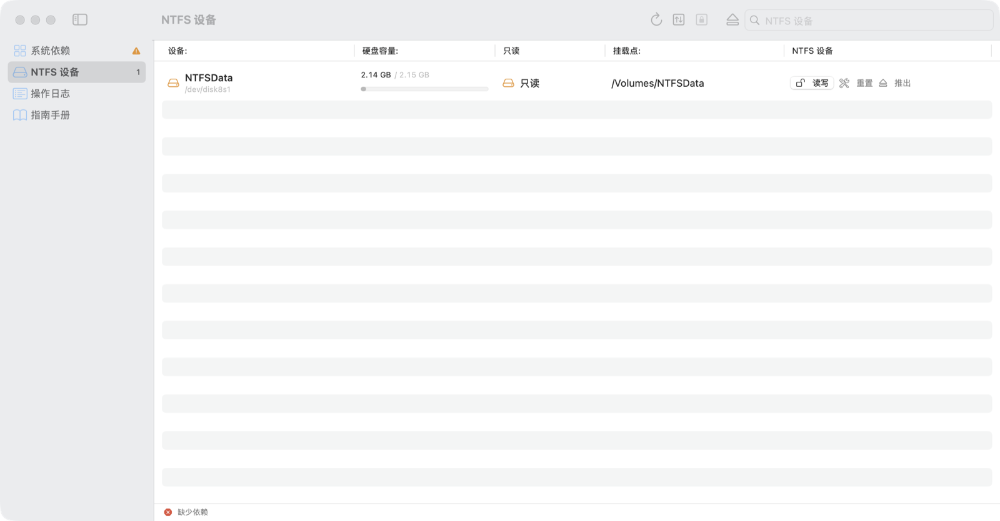
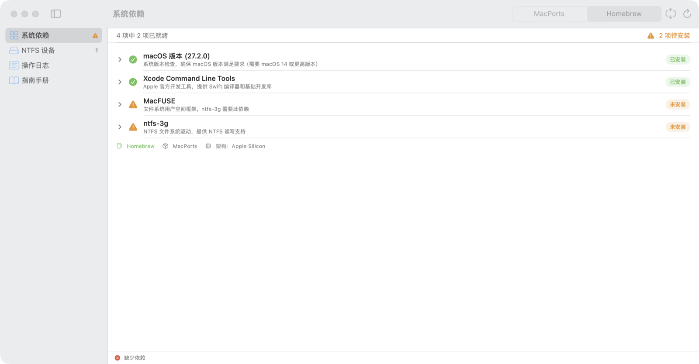
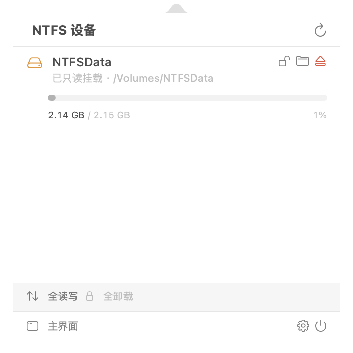
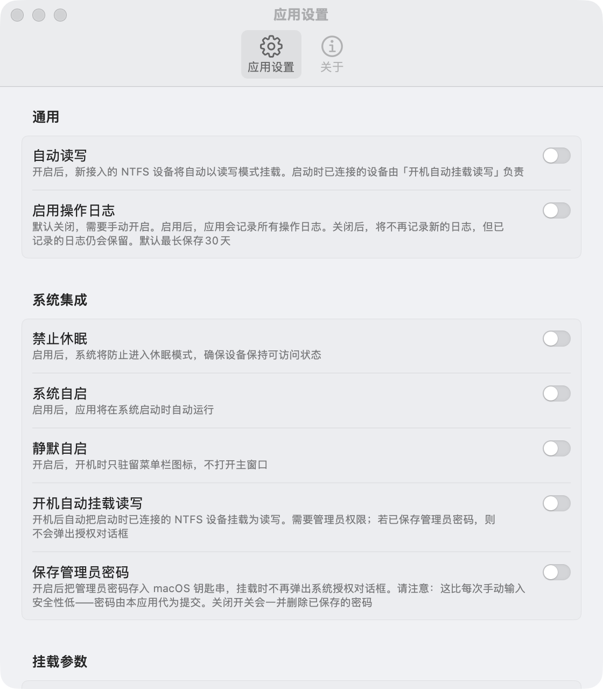
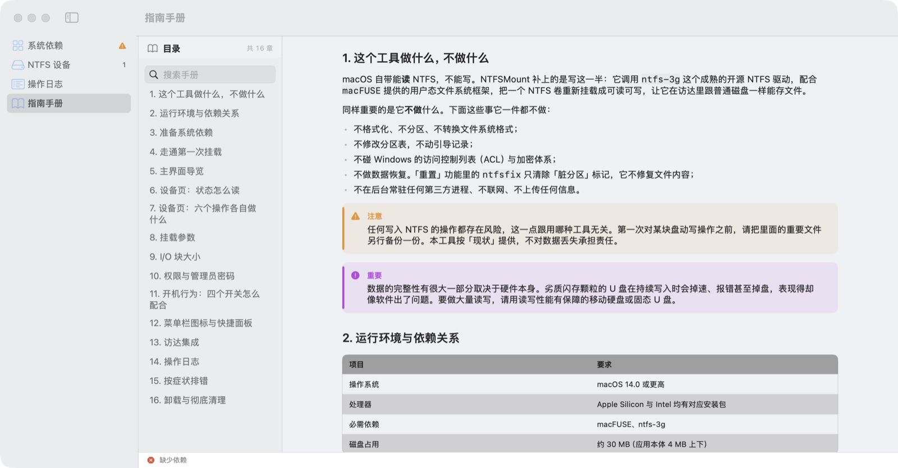

# NTFSMount

**[简体中文](#简体中文) · [English](README_EN.md)**

macOS 上的 NTFS 读写工具，原生 Swift + SwiftUI 实现。制作的起因是上游 [Nigate](https://github.com/hoochanlon/Free-NTFS-for-Mac) 新版不再支持 Intel Mac —— 详见[为什么会有这个项目](#为什么会有这个项目)。

macOS 自带只读的 NTFS 支持。本工具调用 **ntfs-3g + macFUSE**，把 NTFS 卷重新挂载为可读可写，
并在菜单栏与访达中提供快速操作。



---

# 简体中文

## 为什么会有这个项目

我一直用 **[Nigate](https://github.com/hoochanlon/Free-NTFS-for-Mac)**（原名
Free-NTFS-for-Mac，GitHub 仓库地址沿用至今）在 macOS 上读写 NTFS 移动盘

问题是：最新版 v1.5.4 已只发布 Apple Silicon（arm64）构建 —— Intel Mac 被建议
留在 1.4.5；发布说明也写明后续版本不再支持 Intel，理由是 macOS 27 已不再支持 Intel Mac。
我 clone 到的是旧版，于是决定自己动手，用原生 Swift 重写。


## 应用介绍


### 原生应用

| | NTFSMount | Nigate 1.5.4 |
|---|---|---|
| 安装包体积 | **约 2 MB** | 约 98 MB |
| 运行时 | 原生 Swift / SwiftUI | Electron |
| 内存占用 | 约 40 MB | — |

### 零常驻子进程、零轮询定时器

设备变化来自 IOKit 匹配/终止通知端口与 NSWorkspace 挂载事件，空闲时 CPU 为 0。

单轮全量刷新约 **3~5 ms**。

### 依赖判定不把 Homebrew 当必要条件

`核心依赖 = macOS 版本 × macFUSE × ntfs-3g`，**不含 Homebrew**。
MacPorts、Homebrew方式在检测上完全等价 —— 没有 Homebrew 的机器不会被误判成
「缺少依赖」。考虑到上面提到的 Intel 现状，这一点对 Intel 用户尤其重要。

### 界面与系统集成

- 菜单栏常驻：左键弹快捷面板，右键弹菜单；关闭主窗口不退出
- 访达集成：卷状态徽标 + 右键菜单（挂载 / 卸载、切换读写、推出、ntfsfix）
- 静默自启：开机只留菜单栏图标，不弹主窗口
- 开机自动挂载读写
- 管理员密码可选存入钥匙串，免去每次挂载弹窗

## 功能一览

| | |
|---|---|
| 读写挂载 | 调用 ntfs-3g + macFUSE，把 NTFS 卷挂载为可读可写 |
| 设备识别 | 走 IOKit / DiskArbitration 系统 API，**不依赖任何第三方驱动** —— 驱动还没装也能看到磁盘 |
| 刷新方式 | 事件驱动（IOKit 匹配/终止通知 + NSWorkspace 挂载事件），无轮询定时器 |
| 常驻子进程 | 0 个 |
| 内存占用 | 约 40 MB |
| 菜单栏驻留 | 左键点图标弹快捷面板，右键弹菜单；关闭主窗口不退出 |
| 访达集成 | 卷状态徽标 + 右键菜单（挂载 / 卸载、切换读写、推出、ntfsfix） |
| 架构 | Apple Silicon (arm64) 与 Intel (x86_64) 分别出包 |
| 最低系统 | macOS 14 |

## 应用截图

| 系统依赖 | NTFS 设备 |
|---|---|
|  |  |

| 菜单栏快捷面板（左键点图标） | 设置 |
|---|---|
|  |  |

使用手册（16 章）内置于应用，不联网即可查看：



## 它能做什么，不能做什么

**能做**：把已存在的 NTFS 卷挂载为可读写；挂载 / 卸载 / 还原只读；`ntfsfix` 清除「脏分区」标记。

**不做**：不格式化、不分区、不转换文件系统；不修改分区表与引导记录；不碰 Windows 的访问控制列表；
不恢复数据；不在后台常驻第三方进程、不联网、不上传任何信息。

> **写 NTFS 有风险，与用哪种工具无关。** 第一次对某块盘写操作之前，请把里面的重要文件另备份一份。
> 「重置」功能里的 `ntfsfix` 只清除「脏分区」标记，它不修复文件内容。

## 安装

### 1. 安装应用

下载对应架构的 DMG，双击挂载后把 `NTFSMount.app` 拖进「应用程序」。

- Apple Silicon（M 系列）：`NTFSMount-1.0.0-arm64.dmg`
- Intel：`NTFSMount-1.0.0-x86_64.dmg`

### 2. 安装依赖

读写能力来自 macFUSE + NTFS-3G，需要单独安装。应用内「系统依赖」页会检测并给出对应命令。

**MacPorts**

```bash
sudo port install macfuse      # 安装后需在「系统设置 → 通用 → 登录项与扩展」中允许
sudo port install ntfs-3g
```

**Homebrew**

```bash
brew install --cask macfuse
brew tap gromgit/homebrew-fuse
brew install ntfs-3g-mac
```

## 使用

### 挂载为读写

在主界面「NTFS 设备」页点某台设备的「读写」，或左键点菜单栏图标在快捷面板里操作。
挂载需要管理员权限，会弹出系统授权对话框。

### 设置项

| 设置 | 作用 |
|---|---|
| 自动读写 | 新接入的 NTFS 设备自动挂载为读写 |
| 系统自启 | 登录时自动启动应用 |
| 静默自启 | 开机只驻留菜单栏图标，不打开主窗口 |
| 开机自动挂载读写 | 启动时把已经连着的 NTFS 设备挂载为读写 |
| 保存管理员密码 | 把管理员密码存入 macOS 钥匙串，挂载时不再弹授权对话框 |
| I/O 块大小 | 传给 macFUSE 的 `iosize`，影响大文件吞吐；默认 1 MiB |

> **保存管理员密码**：密码由本应用代为提交给系统提权接口，
> 存在登录钥匙串里（`kSecAttrAccessibleWhenUnlocked`，锁屏状态下不可读）。
> 如果密码被改动，应用会自动丢弃旧密码并退回系统授权对话框。不想要就关掉。

## 许可

[GNU General Public License v3.0](LICENSE)（GPL-3.0）。

## 致谢

本工具的读写能力建立在下面两个开源项目之上：

- **[macFUSE](https://macfuse.github.io/)** —— 用户态文件系统框架，提供本工具挂载 NTFS 的内核通道
- **[NTFS-3G](https://github.com/tuxera/ntfs-3g)**（Tuxera）—— NTFS 读写驱动本体

界面与交互的设计思路受 [Nigate](https://github.com/hoochanlon/Free-NTFS-for-Mac)
启发，在此致谢。
